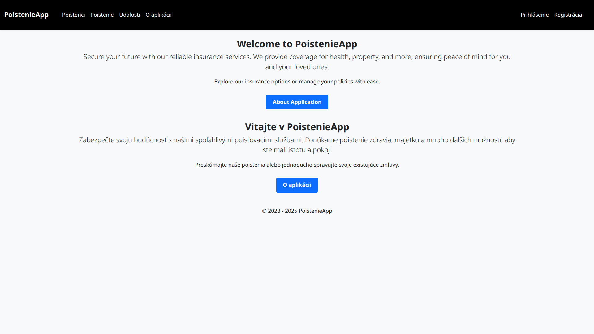
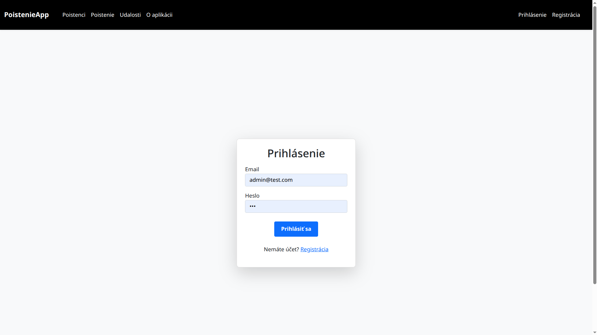
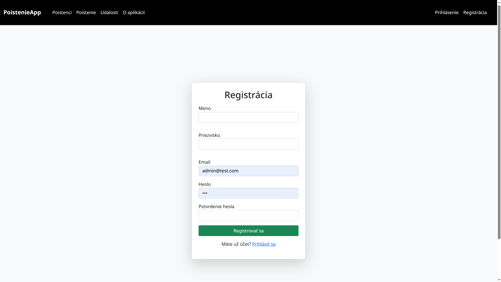
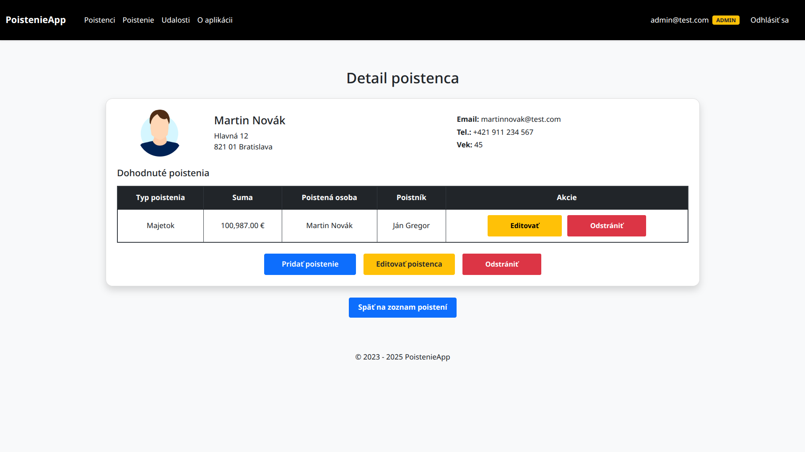
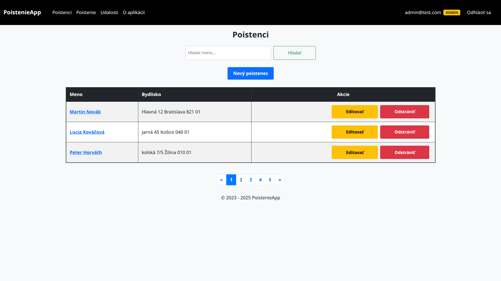
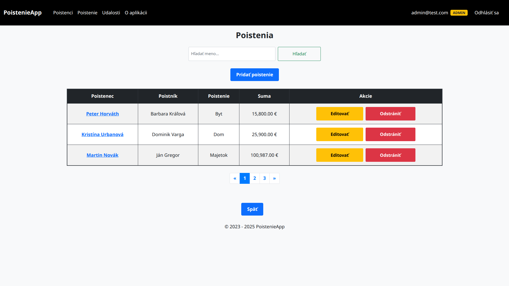
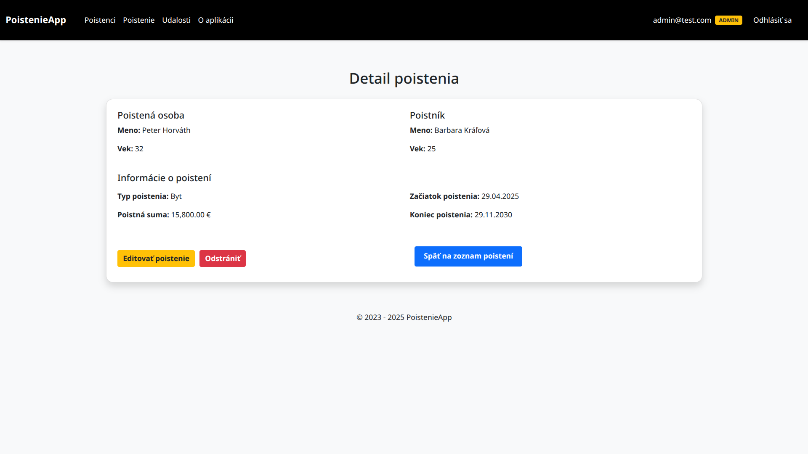

# 🛡️ InsuranceApp

A web application for managing insurance records, built with **Java**, **Spring Boot**, **Spring Security**, **Thymeleaf**, and **Bootstrap**.

---

## 🚀 Run the Project

The complete local setup and run instructions are documented here:

👉 **[docs/RUN.md](docs/RUN.md)**

The guide covers:

- prerequisites
- starting the MariaDB database with Docker Compose
- running the Spring Boot application
- accessing the application locally
- stopping the local environment

---

## 👥 User Roles and Registration

- 👤 **Admin** can manage all insured persons.
- 📝 **New users** can register through the registration form.
- 🔒 Regular users have access to their own permitted data.

No test passwords or production credentials are stored in this repository.

---

## 🔐 Password Reset

The application supports password reset by email.

- reset tokens are generated as UUIDs
- reset links are valid for 15 minutes
- a token is invalidated after a successful password reset
- production database schema changes are managed through **Flyway**

Production troubleshooting and solved deployment issues are documented in:

`docs/troubleshooting/`

---

## 🖼️ Screenshots

<p float="left">
  
  
  
</p>

<p float="left">
  
  
  
</p>

<p float="left">
  
</p>

> 📂 All screenshots are stored in the `screenshots/` folder.

---

## 🛠️ Technologies Used

- Java 17+
- Spring Boot
- Spring Security
- Thymeleaf
- Bootstrap 5
- MariaDB
- Flyway
- Maven
- Docker / Docker Compose
- JUnit / Mockito
- Prometheus / Grafana

---

## 🧪 Tests

The project uses automated tests with JUnit and Mockito.

Run the test suite with:

```bash
mvn clean test
```

---

## 📚 Documentation

Additional technical documentation is available in:

```text
docs/
├── RUN.md
└── troubleshooting/
```

The troubleshooting documentation records important development, deployment, infrastructure, and production issues together with their solutions.

---

## 📄 License

This project is licensed under the MIT License.

---

# 🛡️ PoistenieApp

Webová aplikácia na správu poistenia vytvorená pomocou **Java**, **Spring Boot**, **Spring Security**, **Thymeleaf** a **Bootstrapu**.

## 🚀 Spustenie projektu

Kompletný návod na lokálne spustenie aplikácie je v:

👉 **[docs/RUN.md](docs/RUN.md)**

V návode je popísané:

- čo je potrebné mať nainštalované
- spustenie MariaDB cez Docker Compose
- spustenie Spring Boot aplikácie
- adresa lokálnej aplikácie
- zastavenie lokálneho prostredia

## 👥 Používateľské roly a registrácia

- 👤 **Admin** môže spravovať všetkých poistencov.
- 📝 **Nový používateľ** sa môže zaregistrovať cez registračný formulár.
- 🔒 Bežný používateľ má prístup k povoleným údajom podľa svojej role.

V repozitári nie sú uložené testovacie heslá ani produkčné prihlasovacie údaje.

## 🔐 Obnova hesla

Aplikácia podporuje obnovu hesla prostredníctvom e-mailu.

- reset token je UUID
- platnosť tokenu je 15 minút
- po úspešnej zmene hesla sa token zneplatní
- zmeny produkčnej databázovej schémy spravuje Flyway

Technická dokumentácia a troubleshooting sú v:

```text
docs/troubleshooting/
```

## 🧪 Testy

Testy je možné spustiť:

```bash
mvn clean test
```

## 📚 Dokumentácia

```text
docs/
├── RUN.md
└── troubleshooting/
```

---

## 📄 Licencia

Projekt je licencovaný pod MIT licenciou.
